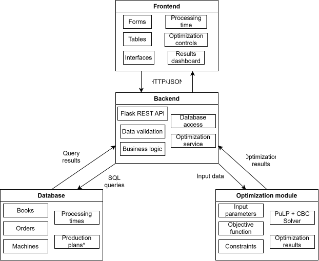

# Drukāšanas pasūtījumu izpildes plānošana
## Sistēmas izstrādes plāns

### 1. Sistēmas komponentu mijiedarbība

Sistēma sastāv no frontend, backend, datu bāzes un optimizācijas moduļa.

**Galvenā datu plūsma:**

Frontend → Backend → Datu bāze / Optimizācijas modulis → Backend → Frontend

Frontend nodrošina lietotāja mijiedarbību ar sistēmu. Backend apstrādā pieprasījumus, pārbauda datus, veic datu bāzes operācijas un izsauc optimizācijas moduli.

### 2. Frontend izstrāde

| Nr. | Funkcionalitāte | Kas jārealizē |
|---|---|---|
| FE1 | Grāmatu pārvaldība | Grāmatu pievienošanas forma (nosaukums, peļņa par vienību) un grāmatu saraksts |
| FE2 | Pasūtījumu pārvaldība | Pasūtījuma izveides forma ar grāmatas izvēli un minimālā tirāžas daudzuma ievadi; pasūtījumu saraksts |
| FE3 | Iekārtu pārvaldība | Iekārtu pievienošanas forma (nosaukums, pieejamais darbības laiks) un iekārtu saraksts |
| FE4 | Apstrādes laiku ievade | Tabula, kurā katrai grāmatai var norādīt nepieciešamo darbības laiku uz katras iekārtas |
| FE5 | Optimizācijas palaišana | Poga optimālā drukāšanas plāna aprēķināšanai |
| FE6 | Plāna attēlošana | Tabula ar katra pasūtījuma drukājamo daudzumu, kopējo peļņu un grafisku rezultātu attēlojumu |
| FE7 | Iekārtu noslodze | Izmantotā un atlikušā darbības laika attēlošana |
| FE8 | Datu rediģēšana | Iepriekš ievadīto grāmatu un iekārtu datu rediģēšanas iespēja |
| FE9 | Iepriekšējie plāni | Saglabāto plānu saraksts un apskate, ja tiek realizēta F12 |
| FE10 | Kļūdu apstrāde | Validācijas kļūdu, nepilnīgu datu un neveiksmīgas optimizācijas paziņojumi |

**Frontend rezultāts:** lietotājs var ievadīt un apskatīt datus, palaist optimizāciju un apskatīt aprēķināto plānu.

### 3. Backend izstrāde

| Nr. | Funkcionalitāte | Kas jārealizē |
|---|---|---|
| BE1 | Grāmatu API | Grāmatu izveide un saraksta iegūšana |
| BE2 | Pasūtījumu API | Pasūtījumu izveide un saraksta iegūšana, sasaistot pasūtījumu ar grāmatu |
| BE3 | Iekārtu API | Iekārtu izveide un saraksta iegūšana |
| BE4 | Apstrādes laiku API | Grāmatu un iekārtu apstrādes laiku saglabāšana un iegūšana |
| BE5 | Datu validācija | Obligāto lauku, datu tipu, vērtību diapazonu un saistīto ierakstu pārbaude |
| BE6 | Optimizācijas datu sagatavošana | Pasūtījumu, iekārtu un apstrādes laiku iegūšana no DB un pārveidošana algoritma ievaddatos |
| BE7 | Optimizācijas izsaukšana | Optimizācijas moduļa palaišana un rezultāta saņemšana |
| BE8 | Rezultāta apstrāde | Aprēķina statusa, drukājamo daudzumu, peļņas un iekārtu noslodzes sagatavošana frontend |
| BE9 | Datu rediģēšana | Grāmatu un iekārtu ierakstu atjaunināšana |
| BE10 | Plānu saglabāšana | Aprēķināto plānu saglabāšana un iegūšana, ja tiek realizēta F12 |
| BE11 | Kļūdu apstrāde | Strukturētas API kļūdu atbildes un optimizācijas kļūdu apstrāde |

**Backend rezultāts:** frontend var strādāt ar datiem un optimizācijas moduli, neizmantojot tiešu piekļuvi DB vai algoritmam.

### 4. Datu bāzes izstrāde

Balstoties uz konceptuālo modeli, jānodrošina šādu datu glabāšana:

| Dati | Saturs |
|---|---|
| Grāmatas | Identifikators, nosaukums, peļņa par vienību |
| Pasūtījumi | Identifikators, grāmatas identifikators, minimālais tirāžas daudzums, maksimālais daudzums (neobligāts, F13) |
| Iekārtas | Identifikators, nosaukums, pieejamais darbības laiks |
| Apstrādes laiki | Grāmatas un iekārtas identifikatori, laiks vienas grāmatas apstrādei |
| Drukāšanas plāni | Aprēķinātā peļņa un plāna dati, ja tiek realizēta saglabāšana |
| Plāna rindas | Pasūtījums un aprēķinātais drukājamais daudzums |
| Iekārtu noslodze | Izmantotais un atlikušais iekārtu darbības laiks |

Jādefinē primārās un ārējās atslēgas, datu tipi, obligātie lauki un ierobežojumi.

### 5. Optimizācijas moduļa izstrāde

| Nr. | Uzdevums | Kas jārealizē |
|---|---|---|
| OPT1 | Ievaddati | Pieņemt pasūtījumu, peļņas, minimālo tirāžu, iekārtu un apstrādes laiku datus |
| OPT2 | Matemātiskais modelis | Definēt lēmuma mainīgos, mērķa funkciju un ierobežojumus |
| OPT3 | Risinājuma aprēķināšana | Atrisināt optimizācijas uzdevumu, izmantojot PuLP un CBC |
| OPT4 | Rezultāta sagatavošana | Atgriezt drukājamo daudzumu, kopējo peļņu un iekārtu noslodzi |
| OPT5 | Neiespējama risinājuma apstrāde | Atgriezt atbilstošu statusu, ja ierobežojumus nav iespējams izpildīt |

Optimizācijas modulis saņem sagatavotus datus no backend un neatkarīgi nepiekļūst datu bāzei.

### 6. Frontend un backend mijiedarbība

Sākotnēji tika plānots, ka visas darbības notiek caur JSON API. Starpversijā izvēlēta
**vienkāršāka pieeja**: datu ievades formas apstrādā serveris (Flask + Jinja veidnes,
standarta HTML formas), bet JSON tiek izmantots tikai plāna aprēķinam, ko izsauc JavaScript.
Tā koda ir daudz mazāk, un tehnoloģiju steks paliek tas pats.

| Frontend darbība | Plānotais API | Realizācija starpversijā |
|---|---|---|
| Atvērt / pievienot grāmatas | `GET`, `POST /api/books` | lapa `GET /books`, forma `POST /books` |
| Atvērt / pievienot pasūtījumus | `GET`, `POST /api/orders` | lapa `GET /orders`, forma `POST /orders` |
| Atvērt / pievienot iekārtas | `GET`, `POST /api/machines` | lapa `GET /machines`, forma `POST /machines` |
| Apstrādes laiki | `GET`, `PUT /api/processing-times` | tabula `GET /processing-times`, forma `POST /processing-times` (visa tabula vienā reizē) |
| Aprēķināt plānu | `POST /api/optimize` | `POST /api/optimize` (JSON, izsauc JavaScript) — kā plānots |
| Apskatīt plānu | — | lapa `GET /plans/{id}` (atveras pēc aprēķina) |
| Rediģēt grāmatu / iekārtu | `PUT /api/books/{id}`, `PUT /api/machines/{id}` | nākamajā versijā (F11) |

HTML formas izmanto `POST`, jo pārlūka formas neatbalsta `PUT`.

**API vienošanās:**
- Pieprasījumu un atbilžu dati tiek pārsūtīti JSON formātā.
- Ieraksti tiek identificēti ar unikāliem ID.
- Backend atgriež atbilstošus HTTP statusa kodus (201 — plāns izveidots, 422 — plānu nevar aprēķināt).
- Kļūdu gadījumā atbilde satur kļūdas aprakstu laukā `error`.
- Frontend izmanto backend atgrieztos datus un neaprēķina optimizācijas rezultātus patstāvīgi.

### 7. Izstrādes secība un atkarības

| Posms | Frontend | Backend / DB | Optimizācija |
|---|---|---|---|
| 1 | Sagatavot lapu struktūru un formas | Izveidot DB struktūru un sākotnējo API | Definēt matemātisko modeli |
| 2 | Izveidot datu sarakstus un ievades validāciju | Realizēt datu saglabāšanu, iegūšanu un validāciju | Realizēt aprēķinu ar testa datiem |
| 3 | Savienot formas ar API | Realizēt optimizācijas izsaukšanu un rezultātu API | Pārbaudīt aprēķinus un kļūdu statusus |
| 4 | Izveidot plāna un peļņas attēlošanu | Integrēt aprēķinu ar DB datiem | Pārbaudīt integrācijas rezultātus |
| 5 | Rediģēšana, papildu funkcijas | Rediģēšanas un plānu saglabāšanas API | Nepieciešamie labojumi |
| 6 | Saskarnes testēšana | API un DB testēšana | Aprēķinu testēšana |

**Svarīgi:** frontend un optimizācijas moduli var izstrādāt paralēli backend izstrādei, ja iepriekš ir saskaņoti datu formāti.

### 8. Integrācijas pārbaude

Pēc komponentu savienošanas jāpārbauda viens pilns scenārijs:

1. Lietotājs pievieno grāmatu un pasūtījumu.
2. Lietotājs pievieno iekārtas un norāda apstrādes laikus.
3. Backend saglabā un iegūst datus no DB.
4. Lietotājs palaiž optimizāciju.
5. Backend nodod datus optimizācijas modulim.
6. Optimizācijas modulis atgriež rezultātu.
7. Frontend attēlo plānu un kopējo peļņu.
8. Tiek pārbaudīts, vai aprēķins ievēro minimālos tirāžus un iekārtu darbības laika ierobežojumus.

Ja šis scenārijs darbojas korekti, sistēmas galvenā funkcionalitāte ir integrēta.

### 9. Sistēmas Struktūras modelis

Labākai plāna uztverei tika izveidots struktūras modelis, kurš vizuāli atspoguļo visas komponentes un to sastāvdaļas.

